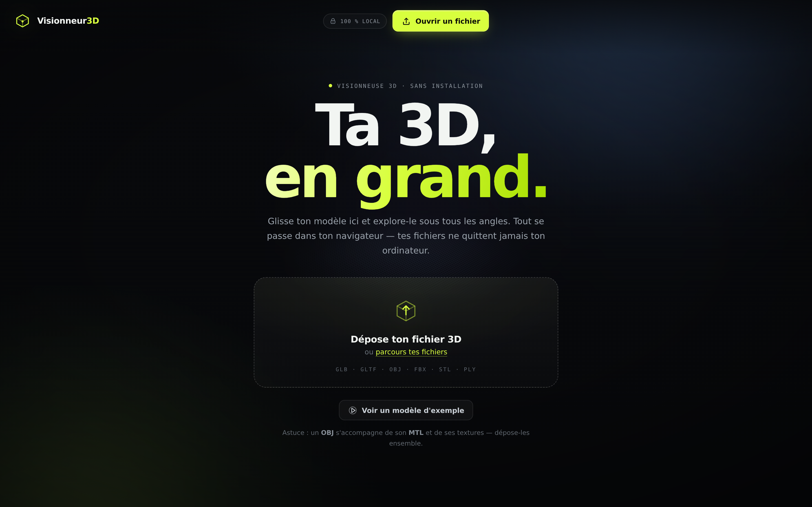
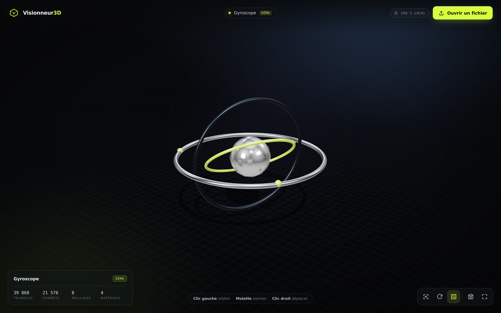

# Visionneur3D

Une visionneuse 3D qui tourne **entièrement dans le navigateur**. Tu glisses ton modèle, tu l'explores sous tous les angles — aucun fichier n'est envoyé sur un serveur, aucune installation, aucun compte.



## Démarrer

```bash
npm install
npm run dev        # http://localhost:5173
```

Pour la version de production :

```bash
npm run build      # génère dist/
npm run preview    # sert dist/ en local
```

`dist/` est un site statique : tu peux le déposer tel quel sur Netlify, Vercel, GitHub Pages, Cloudflare Pages ou n'importe quel hébergement de fichiers. Aucun backend, aucune base de données.

## Formats pris en charge

| Format | Extensions | Remarques |
| --- | --- | --- |
| glTF 2.0 | `.glb`, `.gltf` | Le format recommandé. Draco et textures KTX2/Basis gérés. |
| Wavefront OBJ | `.obj` (+ `.mtl`, textures) | Dépose l'OBJ **avec** son MTL et ses images dans le même geste. |
| FBX | `.fbx` | Exporte de préférence en FBX 2014/2015 ; les animations intégrées sont lues. |
| STL | `.stl` | ASCII et binaire. Idéal impression 3D. |
| PLY | `.ply` | ASCII et binaire, couleurs par sommet affichées. |

Les fichiers natifs des logiciels (`.blend`, `.max`, `.c4d`, `.ma`, `.ztl`) ne sont pas lisibles par un navigateur : la visionneuse te rappelle alors la manip d'export vers glTF.

## Fonctionnalités

- **Glisser-déposer** au centre de l'écran, ou bouton « Ouvrir un fichier ».
- **Plusieurs fichiers d'un coup** : un OBJ + son MTL + ses textures, ou plusieurs modèles affichés côte à côte.
- **Cadrage automatique** : le modèle est centré et dimensionné quelle que soit son échelle d'origine (une pièce de 2 mm comme un bâtiment de 300 m).
- **Éclairage studio** (environnement PBR + 3 lumières directionnelles) et ombre portée douce sur une grille au sol.
- **Orbite / zoom / déplacement** à la souris ou au doigt, rotation automatique optionnelle, recentrage animé.
- **Fiche modèle** : nom, format, nombre de triangles, de sommets, de maillages et de matériaux.
- **Capture d'écran** en PNG (fond dégradé inclus), **plein écran**, **grille on/off**.
- **Animations** des fichiers GLB/FBX jouées automatiquement.
- **Messages d'erreur utiles** : fichier corrompu, texture manquante, format propriétaire…



## Raccourcis

| Touche | Action |
| --- | --- |
| `R` | Recentrer la vue |
| `Espace` | Rotation automatique |
| `G` | Afficher / masquer la grille |
| `S` | Capture d'écran PNG |
| `F` | Plein écran |

## Vie privée

Tous les fichiers sont lus localement via l'API `File` du navigateur et chargés depuis des URL `blob:` temporaires. Rien n'est transmis, rien n'est stocké. Les seules ressources réseau sont celles du site lui-même (les décodeurs Draco/Basis sont embarqués dans le build).

## Structure

```
index.html             interface (accueil, barre d'outils, fiche modèle)
src/main.js            interactions, glisser-déposer, chargement, toasts
src/viewer.js          scène three.js : rendu, lumières, cadrage, grille, capture
src/assetLoader.js     chargement multi-formats + résolution des ressources liées
src/demo.js            modèle de démonstration généré en direct
src/style.css          design (thème sombre, accent lime, responsive)
public/draco           décodeur Draco (glTF compressé)
public/basis           décodeur Basis/KTX2 (textures compressées)
```

## Compatibilité

Navigateur récent avec WebGL 2 : Chrome, Edge, Firefox, Safari 15+, et navigateurs mobiles récents. Sur mobile, l'interface passe en barre d'outils flottante et la fiche modèle se place au-dessus.

## Licence

MIT.
