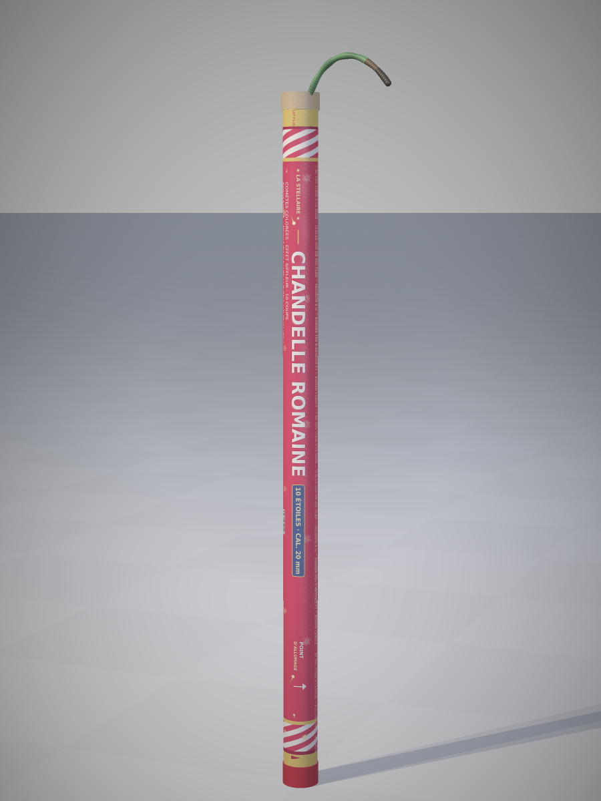

# visionneur3d — Chandelle romaine 3D

Visionneur 3D interactif d'une **chandelle romaine** (feu d'artifice F1),
modélisée d'après les photos de référence de produits réels (tube carton
habillé d'une étiquette imprimée, bourrelet carton avec alésage, mèche visco
tressée, capuchon bas plastique).



## Lancer le visionneur

```bash
python3 -m http.server 8000
# puis ouvrir http://localhost:8000/
```

Aucun build, aucune dépendance : Three.js est vendu dans `vendor/`.

## Fonctionnalités

- **Orbite / zoom / déplacement** à la souris (OrbitControls)
- **Points de vue** : produit, mèche, dessus, héros 3/4
- **Rotation auto** animable
- **« Allumer la mèche »** : la mèche visco brûle (~3 s, étincelles),
  puis 10 comètes colorées sont projetées en l'air à cadence régulière
  (traînées lumineuses, éclats à la bouche, éclairage dynamique)
- Fiche technique et interface en français

## Modèle 3D

Géométrie partagée (en mètres) entre le viewer (`js/candle.js`) et le moteur
de rendu de contrôle (`tools/render_model.py`) :

| Élément | Valeur |
| --- | --- |
| Tube habillé | Ø 21 mm × 398 mm |
| Bourrelet carton | Ø 22,6 mm, hauteur 10 mm |
| Alésage | Ø 14 mm |
| Capuchon bas | Ø 21,8 mm |
| Mèche | bézier cubique, tube Ø 3,5 mm |

L'étiquette (`assets/label.png`, 660 × 3980 px) est générée par
`tools/make_label.py` à l'échelle isotrope 10 px/mm : bandes candy en
spirale, titre « CHANDELLE ROMAINE » le long de l'axe, ruban
« 10 ÉTOILES · CAL. 20 mm », mentions de sécurité, code-barres, motifs
d'étoiles et comètes.

## Démarche d'auto-critique

Un mini-raytracer numpy (`tools/render_model.py`) rend le même modèle avec
les mêmes textures pour comparer visuellement aux photos de référence.
Itérations successives (voir `renders/`) :

| Version | Note | Corrections principales |
| --- | --- | --- |
| v1 | 4,0 | texte orienté autour du tube, proportions étirées |
| v2 | 6,5 | texte axial mais en miroir, alésage bouché, mèche en perles |
| v3 | 8,0 | orientation validée (4 variantes testées), mèche continue |
| v4 | 8,7 | chevauchements typographiques, cadrages |
| v5 | 9,2 | rouge profond, ombre adoucie |
| v6 | 9,4 | rayures, « LOT » lisible, lumière haute |
| v7 | 9,5 | grain papier, tranche du carton, vernis |
| **v8** | **9,6** | **rayures en spirale diagonale, motifs étoiles renforcés** |

Les images de référence utilisées sont dans `image-search/`, les planches de
comparaison dans `renders/comparatif-*.png`.

## Structure

```
index.html            interface du visionneur
css/style.css         thème sombre « studio »
js/main.js            scène, lumières, caméras, boucle
js/candle.js          modèle 3D (géométrie + textures procédurales)
js/effects.js         allumage : mèche, étincelles, comètes
assets/label.png      texture d'étiquette générée
vendor/               Three.js r166 + OrbitControls
tools/make_label.py   générateur de l'étiquette
tools/render_model.py raytracer de contrôle (auto-critique)
renders/              rendus d'itération et comparatifs
image-search/         photos de référence
```
